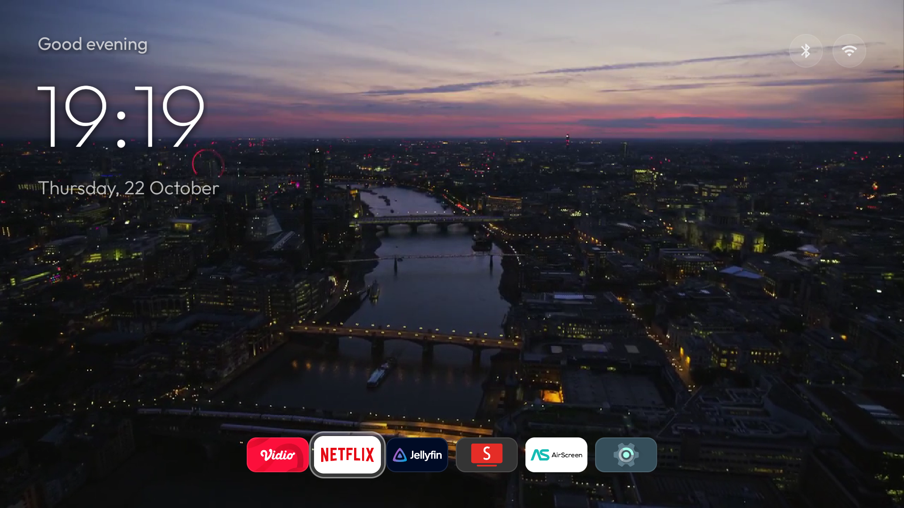
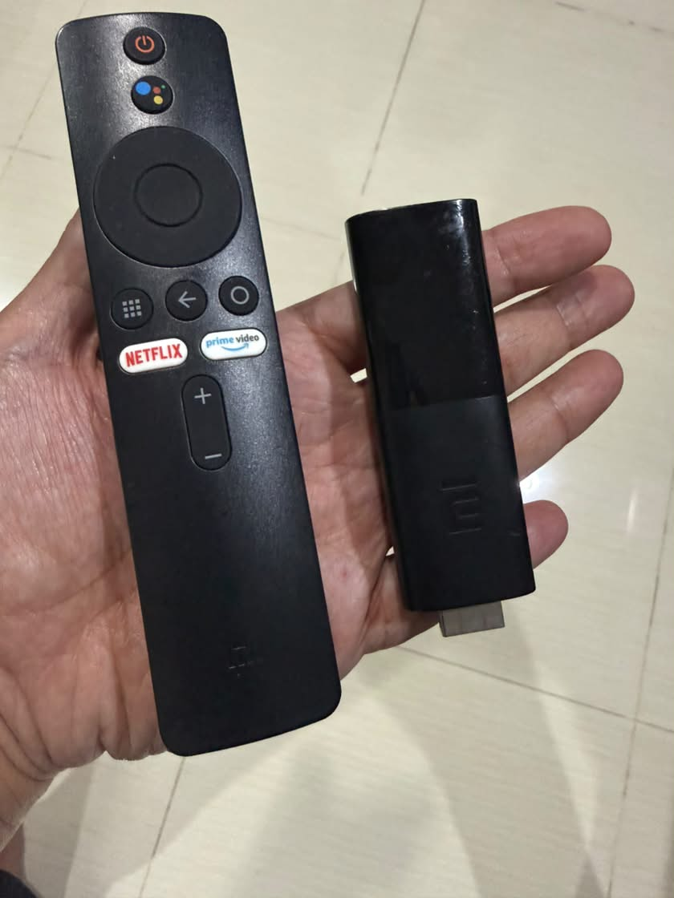

# ExtremeSlimTV

**Extreme debloat for the Mi TV Stick FHD — 47 packages down, an OLED-care launcher, zero bloat.**

A complete makeover of Xiaomi's Mi TV Stick FHD (MDZ-24-AA, model MiTV-AESP0, codename
*aquaman*, 1 GB RAM, Android TV 9), done entirely over Wi-Fi with ADB — no root, nothing
uninstalled, everything reversible. Built and verified on a real unit in daily use in
Depok, Indonesia 🇮🇩.

> **Baru mulai / new here?** There is a complete beginner guide in plain Indonesian —
> [docs/panduan-pemula.md](docs/panduan-pemula.md) — zero to done, step by step, undo included.
> The launcher also ships as a prebuilt APK in
> [Releases](https://github.com/yositapjani/ExtremeSlimTV/releases), no build needed.

*The home screen: aerial video backgrounds that rotate when each clip ends, a five-app dock
(Vidio, Netflix, Jellyfin, SmartTube, Settings), big clock with a soft shadow, Wi-Fi and
Bluetooth status pills. Nothing else.*

*The actual unit this was built and verified on: Mi TV Stick FHD (MDZ-24-AA) with the stock
remote — whose Prime Video button now opens Jellyfin.*

## What's inside

| Part | What it does |
|---|---|
| [`profiles/`](profiles/) | The verified debloat list: **47 packages** disabled on firmware PI.2055, grouped and commented (telemetry, PatchWall rows, Xiaomi/Google plumbing, screensavers, optional voice/accessibility). Disable-only — `pm enable` undoes any line. |
| [`launcher/`](launcher/) | A lean replacement home screen (see **OLED Care** below): aerial video backgrounds that follow the clock (day scenes 06:00–18:00, night scenes 18:00–06:00), centred mini dock, status pills for Wi-Fi and Bluetooth audio (A2DP), large readable clock. |
| [`prime-watcher/`](prime-watcher/) | A tiny daemon that remaps the remote's **Prime Video button to Jellyfin**. The button has no keylayout entry, so no app can see it — the watcher catches it at kernel level via `getevent` over a persistent ADB session and re-finds the stick by MAC when DHCP moves it. |
| [`docs/`](docs/) | The beginner guide (Indonesian, step by step), the debloat method, the OLED Care design, and why Vidio crashes from APKPure's single-APK download (and the XAPK fix). |

## OLED Care — the safety feature

OLED panels burn in on *static, bright* UI. A video background is safe; a dock, a clock and
status icons sitting on the same pixels for hours are not — especially on an always-on stick.

So the launcher protects the panel at launcher level:

- **Micro pixel-shift orbit** — every 4 minutes the whole UI layer (never the video) glides
  a few pixels along a small orbit (±8 px horizontal, ±4 px vertical, 0.8 s animation).
  Invisible in use; no element ever rests on the same pixels for more than 4 minutes.
- **Idle dim** — after 3 minutes without a remote press the UI fades to 65% brightness and
  returns to 100% on the next press.

Verified on hardware with a test build (5× orbit, accelerated timing): the dock measured a
clean +20 px step between screenshots via template matching before the production timings
were set.

## The debloat, briefly

Backup first, then `pm disable-user` for: Xiaomi telemetry and the Alphonso ACR viewing
tracker, PatchWall/content rows, the partner-app auto-installer, Xiaomi services the stick
doesn't need, Google TV plumbing that makes no sense on a tuner-less stick (Live Channels,
sync adapters, print spooler, CTS shims, backup stack), and the screensaver trio. The stick
keeps Netflix, Jellyfin, SmartTube and Vidio, gains back its memory, and stays on PI.2055 —
the firmware update service is in the optional group, disabled on the reference unit.

The same list in [cleanyourtv](https://github.com/Gathin23/cleanyourtv) format was
contributed upstream: [Gathin23/cleanyourtv#828](https://github.com/Gathin23/cleanyourtv/pull/828).

## Before / after — measured, not estimated

Same stick, same firmware, measured both ways on 22 Oct 2026 (`dumpsys meminfo` and
`df` at the home screen, after settling). "Stock" was measured by temporarily
re-enabling the whole profile, restoring the two removed apps and foregrounding the
stock launcher — then re-applying everything and re-verifying (47/47 disabled).

| | Stock (PI.2055) | ExtremeSlimTV | Delta |
|---|---|---|---|
| Packages disabled | 3 of 91 | **47 of 91** (+2 apps removed for the user) | 44 fewer things allowed to run |
| Free RAM | 333 MB | **435 MB** | **+102 MB (+31%)** |
| Used RAM (PSS) | 410 MB | **340 MB** | **−70 MB (−17%)** |
| Running processes | 245 | **235** | −10 |
| Free disk (/data, 4.8 GB) | 3.0 GB | 3.0 GB | unchanged — by design |

The disk row deserves an honest note: this recipe is **disable-only**, so it frees
almost no storage — nothing is deleted, which is exactly why everything is reversible.
What it buys is *headroom*: ~100 MB more free RAM on a 1 GB stick, and the telemetry,
content rows and partner plumbing simply never start.

## Tested on

Xiaomi Mi TV Stick FHD (MDZ-24-AA / MiTV-AESP0 / aquaman), Android TV 9, firmware PI.2055,
Indonesia-region unit. In daily family use since 21 October 2026.

## Safety

- No root, no flashing, no uninstalls: every change is a disable or a settings value.
- Take a package list backup before you start (`adb shell pm list packages`), and you can
  always factory-restore your way out.
- The launcher never phones home: no network permission beyond what Android TV requires.

## Credits

The launcher is a heavily customised descendant of
[kulwantnagi/android-tv-makeover](https://github.com/kulwantnagi/android-tv-makeover)
(MIT, © Kulwant Nagi) — see [`NOTICE.md`](NOTICE.md). The method (backup → disable →
clean launcher → restore path) follows the approach popularised by
[Gathin23/cleanyourtv](https://github.com/Gathin23/cleanyourtv) and the October 2026
Android TV debloat wave. Everything else here — the AESP0 profile, OLED Care, the
prime-watcher daemon, the Vidio finding — is original work from this project.

## Disclaimer

Provided as-is, based on one verified device, with no warranty of any kind. Modifying your
stick always carries some risk — including, in the worst case, a bricked device if a step
goes wrong or power is lost at the wrong moment. **You do this at your own risk; the author
takes no responsibility for any damage to your device.** That said, everything here is
disable-only and reversible, the guide starts with a backup, and the full undo path — up to
a factory reset — is documented. Go slow, and don't skip the backup.

## Licence

MIT — see [`LICENSE`](LICENSE).
